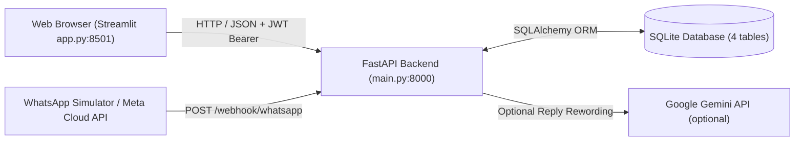

# Jamia Hamdard SMS — Architectural Guide & Workflow Overview
**Department of Computer Science & Engineering | School of Engineering Sciences & Technology (SEST)**  
*Capstone Project-II (BTCSE 701, 6 Credits) | Candidate: Atif Farooqui (2023-310-060)*  
*Supervisor: Ms. Gautami Tripathi*

---

## 1. System Overview

The **Departmental Academic Record, Result, Attendance & Self-Service Management System** replaces manual spreadsheets with a local client-server web portal:
- **Streamlit Frontend (`app.py`, port 8501):** Login screen, Faculty Dashboard (7 tabs), and Student Portal (6 tabs).
- **FastAPI REST Backend (`main.py`, port 8000):** JWT authentication, PBKDF2 password hashing, role-based access control (RBAC), Pydantic boundary validation, SGPA/attendance calculations, self-service views, and the query assistant endpoints.
- **SQLite + SQLAlchemy ORM (`academic_records.db`):** Four normalized tables (`students`, `users`, `courses`, `enrollments`) seeded with fictional demo records (`Aarav Sharma`, `Diya Patel`, `Rohan Verma`).

---

## 2. Security & Role-Based Access Control (RBAC)

- **Password Storage:** Salted PBKDF2-HMAC-SHA256 hashes (100,000 iterations) computed with Python's `hashlib`.
- **Session Tokens:** Signed `HS256` JWT bearer tokens (`PyJWT`) with expiration (`JWT_SECRET_KEY` read from environment, with a development fallback default).
- **Endpoint Enforcement:**
  - Faculty-only CRUD, `/analytics/department`, and `/attendance/batch-register` require `require_faculty` (`HTTP 403` for students).
  - Student self-service routes (`/me/scorecard`, `/me/recovery-calculator`, `/me/admit-card`, `/me/no-dues`) derive identity strictly from the verified JWT payload.
  - Web Query Assistant (`POST /ai/chat`) requires `get_current_user` (`HTTP 401` when unauthenticated) and restricts student callers to their own scorecard, own attendance recovery calculation, and general illustrative FAQ responses (`HTTP 403` for department-wide shortages, department analytics, circular drafting, or peer records).
  - **Demonstration Webhook Scope:** `POST /webhook/whatsapp` is kept open without per-caller JWT login for Meta Cloud API and in-app simulator testing (a production rollout would bind sender phone numbers to verified accounts and validate `X-Hub-Signature-256`).

---

## 3. Query Assistant Design (Rule-Based Router + Optional Gemini Rewording)

The query assistant (`run_ai_tool_calling_agent` in `main.py`) is **not** a model-driven tool-calling agent:
1. Incoming text is lowercased and matched against fixed Python keyword lists across six branches (`query_attendance_shortages`, `calculate_attendance_recovery`, notice drafting `draft_*_notice`, `query_student_scorecard`, `compute_department_analytics`, and `academic_rulebook_faq` fallback).
2. The matched Python function queries SQLite via SQLAlchemy and builds a grounded deterministic reply.
3. If `GEMINI_API_KEY` is configured, that grounded reply is optionally sent to the Gemini API for natural-language rewording; otherwise, or on timeout/error, the locally built reply is returned unchanged.

---

## 4. Attendance Recovery Derivation

For attended classes $A$ and held classes $H$, meeting the configured $75\%$ illustrative threshold requires $x$ consecutive attended lectures:

$$\frac{A + x}{H + x} \ge 0.75 \implies A + x \ge \frac{3}{4}H + \frac{3}{4}x \implies x = \max(0, \lceil 3H - 4A \rceil)$$

---

## 5. Illustrative Content Notice

The 75% attendance threshold, 10-point grade scale (`O=10` down to `F=0`), demonstration admit-card view, sample circular templates, and the Library/Accounts/Proctor items in the No-Dues view (only Practical Labs reads real stored attendance) are illustrative demonstration defaults, not verified official university regulations.

---

## 6. Verification Status

- **Automated Test Suite (`test_main.py`):** 30 out of 30 pytest cases (`TC-01` through `TC-30`) passing against an isolated temporary SQLite database.
