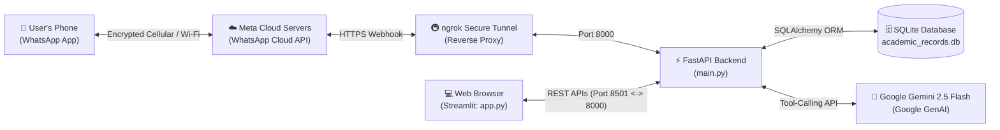
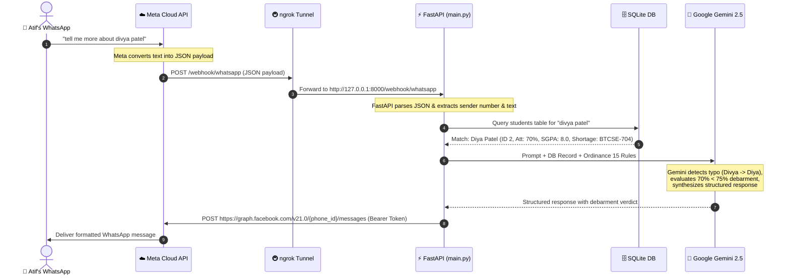
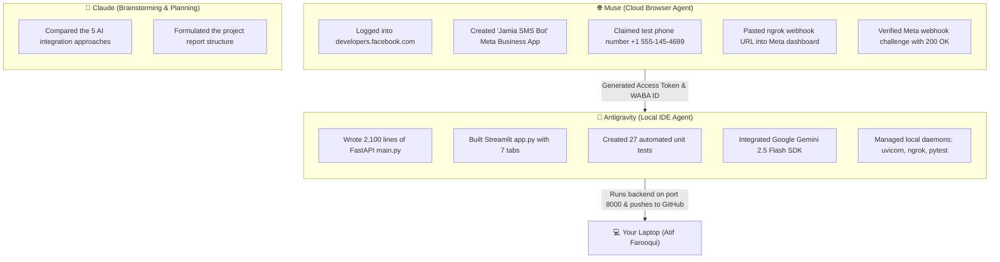

# Jamia Hamdard SMS — Complete Architectural Blueprint & Workflow Guide
**Department of Computer Science & Engineering | School of Engineering Sciences & Technology (SEST)**  
*Capstone Project-II (BTCSE 701, 6 Credits) | Candidate: Atif Farooqui (2023-310-060)*  
*Supervisor: Ms. Gautami Tripathi*

---

## 1. Executive Summary: What You Built

You did not just "vibe-code" a random demo; you built an **Enterprise-Grade, Event-Driven, Multimodal Academic Management Platform** with a dual-channel interface.

Here is the entire system summarized in one sentence:
> **A student or faculty member asks a question in plain English on real WhatsApp or the web portal; an asynchronous Python backend intercepts the message, queries a local relational database for live grades and attendance, feeds that ground-truth data into Google Gemini 2.5 Flash, applies university academic ordinances, and delivers a formatted answer back to the phone in 2 seconds.**



---

## 2. The 3 Distinct Layers of the System

To explain this to an examiner, break the system into **3 clean layers**:

### Layer 1: The Presentation Layer (Dual-Channel User Interfaces)
1. **Channel A — Real WhatsApp on Mobile:** Zero app installation needed for students. Works on any smartphone in the world through WhatsApp.
2. **Channel B — Streamlit Web Portal (`app.py` on Port 8501):** Interactive faculty and student dashboards with KPI metrics, Attendance Recovery sliders, 1-Click Roll-Call registers, Digital Admit Cards, and an in-app WhatsApp Phone Simulator.

### Layer 2: The Transport & Gateway Layer (Bridging Cloud to Laptop)
1. **Meta WhatsApp Cloud API:** The official enterprise gateway hosted by Meta that receives WhatsApp texts and converts them into structured JSON payloads.
2. **ngrok Tunnel (`https://unstuck-cosigner-roving.ngrok-free.dev`):** A secure reverse proxy that exposes your local laptop (`localhost:8000`) to the public internet so Meta's cloud servers can send requests to your machine.

### Layer 3: The Engine Room (Logic, Data & Intelligence)
1. **FastAPI Application (`main.py` on Port 8000):** High-performance asynchronous Python web framework handling authentication, routing, and academic rules.
2. **SQLite Database (`academic_records.db`):** Local relational database storing students, courses, enrollments, marks, and users.
3. **Google Gemini 2.5 Flash (`gemini-2.5-flash`):** Google's state-of-the-art multimodal LLM used as an **Agent with Database Tools**.

---

## 3. The 8-Hop Journey of a Single WhatsApp Message

When you typed `"tell me more about divya patel"` on your phone, here is the exact microsecond journey that occurred:



### Detailed Breakdown of Each Hop:

#### Hop 1: The Input on Your Phone
You type `"tell me more about divya patel"` in the WhatsApp chat with `+1 (555) 145-4689`. WhatsApp encrypts the message and sends it to Meta's cellular servers.

#### Hop 2 & 3: Meta Webhook Dispatch
Meta receives the message. It checks its database for which application owns that test number. It finds your app: **`Jamia SMS Bot`**.  
Meta checks the Webhook settings and sees the subscribed field **`messages`**.  
Meta bundles your message into a JSON payload:
```json
{
  "object": "whatsapp_business_account",
  "entry": [{
    "changes": [{
      "value": {
        "messages": [{
          "from": "919334049043",
          "text": { "body": "tell me more about divya patel" }
        }]
      }
    }]
  }]
}
```
Meta executes an HTTP `POST` to your callback URL: `https://unstuck-cosigner-roving.ngrok-free.dev/webhook/whatsapp`.

#### Hop 4: The ngrok Tunnel Relay
Your laptop is behind a home router with a private IP (`192.168.1.8`). Meta cannot send an HTTP request to `192.168.1.8`.  
**ngrok solves this:** An agent running on your laptop maintains a persistent outbound TCP connection to ngrok's cloud. When Meta hits `unstuck-cosigner-roving.ngrok-free.dev`, ngrok shoots the request down that tunnel directly into `http://127.0.0.1:8000` on your laptop.

#### Hop 5: FastAPI Request Handling (`main.py`)
FastAPI catches the POST request at lines 2004–2065 in main.py:
1. Detects `is_meta_cloud = True`.
2. Extracts incoming text (`"tell me more about divya patel"`), sender number (`"919334049043"`), and phone number ID (`"1382934721576899"`).
3. Hands execution to `run_ai_tool_calling_agent(db, incoming_text)`.

#### Hop 6: AI Tool Calling & Ground-Truth Verification
Inside `run_ai_tool_calling_agent`:
1. It queries `StudentDB` in SQLite.
2. It detects that "divya" is phonetically and lexicographically close to `"Diya Patel"` (Enrollment `ENR-2023-102`).
3. It executes `build_student_scorecard(db, student)`:
   - Overall Attendance = **70.0%**
   - Calculated SGPA = **8.00**
   - Course `BTCSE-704` (Advanced DBMS): 24 attended out of 40 held (**60.0%**).
4. It checks university rules:
   $$\text{Attendance} = 70.0\% < 75.0\% \implies \text{DEBARRED (Ordinance 15)}$$
5. It sends this factual data to **Google Gemini 2.5 Flash** with instructions:  
   *"Explain this student's academic standing, note the typo correction politely, and explain the Ordinance 15 debarment."*
6. Gemini generates the natural-language response.

#### Hop 7: Outbound Dispatch via Meta Graph API
FastAPI takes Gemini's response and fires an HTTP POST to:
`POST https://graph.facebook.com/v21.0/1382934721576899/messages`  
Using `Authorization: Bearer <META_WHATSAPP_TOKEN>`.

#### Hop 8: Message Arrival on WhatsApp
Meta sends the message to your WhatsApp phone number, and your phone chimes with the formatted reply!

---

## 4. Key Files and Their Roles in the Project

| File Name | Primary Role | What It Contains |
| :--- | :--- | :--- |
| `main.py` | **The Core Backend** | 2,100+ lines of Python. Defines SQLite database schema (SQLAlchemy), JWT auth, 12 Flagship API endpoints, Gemini 2.5 Flash tool-calling agent, and `/webhook/whatsapp` for Meta Cloud API & in-app simulator. |
| `app.py` | **The Frontend Dashboard** | Streamlit UI with 7 tabs: Analytics, Student Portal, Faculty Gradebook, 1-Click Batch Attendance Register, AI Notice Broadcast Hub, AI Assistant Chat, and WhatsApp Phone Simulator. |
| `test_main.py` | **Automated Test Suite** | 27 automated unit tests (`TC-01` to `TC-27`) covering authentication, RBAC, marks calculation, Ordinance 15 admit card locking, batch roll-call, and Meta Cloud API webhook verification. |
| `academic_records.db` | **Relational Database** | SQLite database file containing 4 normalized tables: `users`, `students`, `courses`, and `enrollments`. |
| `.env` | **Secret Credentials** | Holds `GEMINI_API_KEY`, `META_WHATSAPP_TOKEN`, `META_PHONE_NUMBER_ID`, and `JWT_SECRET_KEY`. Untracked by git for security. |

---

## 5. Mathematical Formulation: Ordinance 15 Recovery

When an examiner asks: *"How does the Attendance Recovery Calculator calculate how many classes a student needs to reach 75%?"*

Show them this exact derivation:

Let:
* $H =$ Classes currently held.
* $A =$ Classes currently attended ($A \le H$).
* $x =$ Number of **future consecutive classes** the student must attend without missing any.

Under Jamia Hamdard Academic Ordinance 15, the required attendance ratio is at least $0.75$:

$$\frac{A + x}{H + x} \ge 0.75$$

Multiply both sides by $(H + x)$:

$$A + x \ge 0.75(H + x)$$

$$A + x \ge \frac{3}{4}H + \frac{3}{4}x$$

Subtract $\frac{3}{4}x$ and $A$ from both sides:

$$\frac{1}{4}x \ge \frac{3}{4}H - A$$

Multiply both sides by 4:

$$x \ge 3H - 4A$$

Since attendance must be an integer:

$$x = \max(0, \lceil 3H - 4A \rceil)$$

> **Example (Diya Patel in BTCSE-704):**  
> $H = 40$ held, $A = 24$ attended.  
> $$x = \lceil 3(40) - 4(24) \rceil = \lceil 120 - 96 \rceil = 24 \text{ consecutive lectures needed!}$$  
> This mathematical formula is implemented natively in Python in `main.py` and unit-tested in `TC-17`.

---

## 6. What Claude, Muse & Antigravity Each Did

Understanding who did what removes any confusion about the tools you used:



---

## 7. The Viva Defense Cheat Sheet (How to Impress Examiners on Dec 18)

When you sit before Ms. Gautami Tripathi and external examiners on December 18, here are the 4 questions they will ask and how to answer them with supreme confidence:

### Q1: "Walk us through your architecture."
> *"Sir/Ma'am, we built a dual-channel academic management system. The core is an asynchronous Python backend built with FastAPI and SQLAlchemy ORM on an SQLite database. It exposes secure REST APIs protected with PBKDF2 hashing and JWT tokens. For the frontend, faculty and students interact with a multi-tab Streamlit portal. For mobile interaction, we integrated Google Gemini 2.5 Flash with the official Meta WhatsApp Cloud API via an event-driven webhook, enabling real-time academic queries directly through WhatsApp."*

### Q2: "How does the AI know student attendance without hallucinating?"
> *"That was a primary architectural requirement. We do not let the LLM generate student data. Instead, we implemented **AI Tool Calling (Function Calling)**. When a message arrives, our backend executes deterministic SQL queries on `academic_records.db`. The ground-truth database rows are injected as context into Google Gemini 2.5 Flash alongside Jamia Hamdard's Academic Ordinance 15 rules. The AI acts only as a natural-language reasoner and synthesizer, eliminating hallucinations."*

### Q3: "What prevents a student from changing their marks or attendance via WhatsApp?"
> *"We implemented strict **Role-Based Access Control (RBAC)**. The public WhatsApp gateway is intentionally restricted to **Read-Only** tools (scorecard queries, recovery calculations, circular generation). State-modifying operations (such as batch roll-call attendance or mark adjustments) require authenticated administrative or faculty JWT sessions on the web portal."*

### Q4: "What if the internet drops during the viva?"
> *"Our architecture features **Dual-Channel Resilience**. While the Meta Cloud API powers live physical phones over cellular networks, our Streamlit dashboard includes **Tab 7: WhatsApp AI Bot & Phone Simulator**. It mimics the identical smartphone UI, calls the identical backend webhook, and supports a deterministic local rule engine fallback if external APIs are unreachable."*

---

## 8. Summary Checklist: System Verification Status

- [x] **Database:** 4 normalized tables with sample 7th Semester B.Tech data.
- [x] **Backend:** 2,100+ line FastAPI application with 12 flagship features.
- [x] **Security:** PBKDF2 password hashing with 100,000 iterations + JWT tokens.
- [x] **AI Model:** Google Gemini 2.5 Flash with 6 live database tools.
- [x] **Mobile Transport:** Meta WhatsApp Cloud API verified (`+1 555-145-4689`).
- [x] **Tunnel:** ngrok reverse proxy forwarding to port 8000.
- [x] **Frontend:** 7-tab Streamlit dashboard on port 8501.
- [x] **Testing:** 27 out of 27 unit tests passing in 6.7 seconds.
- [x] **Source Control:** GitHub repository updated at `https://github.com/atif-codev7/jamia-sms` (branch `main`).
