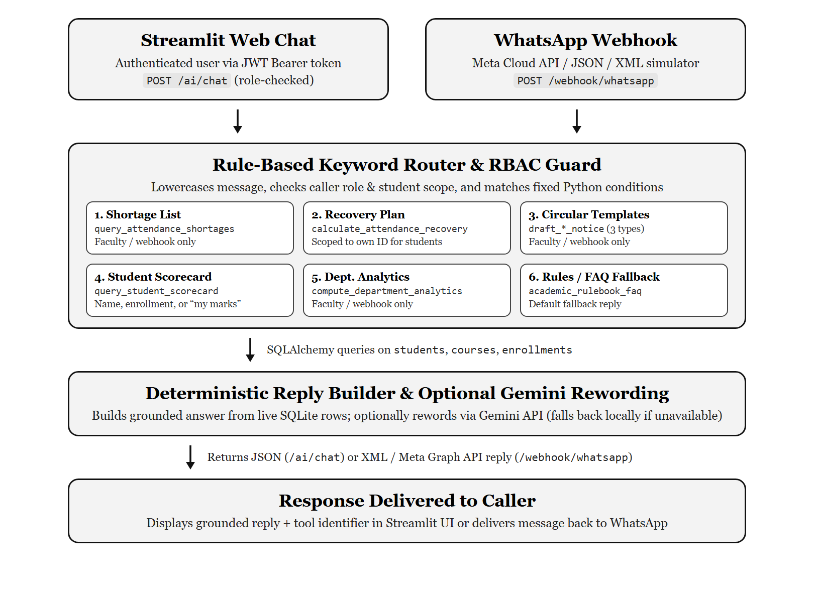

# DEPARTMENTAL ACADEMIC RECORD, RESULT, ATTENDANCE & SELF-SERVICE MANAGEMENT SYSTEM

**PROJECT-II REPORT**

*Submitted by*  
**Atif Farooqui**  
**Enrollment No: 2023-310-060**

*in partial fulfillment for the award of the degree of*  
**BACHELOR OF TECHNOLOGY (COMPUTER SCIENCE & ENGINEERING)**

*Under the supervision of*  
**Ms. Gautami Tripathi**

  

**Department of Computer Science & Engineering**  
**School of Engineering Sciences & Technology**  
# JAMIA HAMDARD  
**New Delhi - 110062**  
**(2026)**

---

## DECLARATION

I, Mr. **Atif Farooqui**, a student of Bachelor of Technology (Computer Science & Engineering) (B.Tech CSE), (Enrollment No: 2023-310-060), hereby declare that the Project entitled *"Departmental Academic Record, Result, Attendance & Self-Service Management System"* which is being submitted by me to the Department of Computer Science & Engineering, School of Engineering Sciences & Technology, Jamia Hamdard, New Delhi in partial fulfillment of the requirement for the award of the degree of **Bachelor of Technology (Computer Science & Engineering)**, is my original work and has not been submitted anywhere else for the award of any Degree, Diploma, Associateship, Fellowship or other similar title or recognition.

____________________________  
**(Signature and Name of the Applicant)**  
**Atif Farooqui**  
**Date:** November 25, 2026  
**Place:** New Delhi

---

## ACKNOWLEDGEMENTS

I would like to thank my supervisor, **Ms. Gautami Tripathi**, for her guidance and for reviewing this project. I also thank the Department of Computer Science & Engineering, Jamia Hamdard, for the resources and environment that made this work possible.

I used a public FastAPI course (Sheryians AI School) as my learning reference for FastAPI, SQLAlchemy and Pydantic, and I used AI-based coding assistants as a development aid while building, testing and documenting this project. I take responsibility for the design decisions and for the contents of this report.

Finally, I thank my family and friends for their support during the semester.

____________________________  
**Atif Farooqui**  
B.Tech (CSE), 7th Semester  
Enrollment No: 2023-310-060  
**Date:** November 25, 2026

---

## 1. TITLE

**DEPARTMENTAL ACADEMIC RECORD, RESULT, ATTENDANCE & SELF-SERVICE MANAGEMENT SYSTEM**  
Project-II (6 credits), B.Tech Computer Science & Engineering, 7th Semester, Jamia Hamdard, New Delhi.  
Student: Atif Farooqui (Enrollment No: 2023-310-060)  
Supervisor: Ms. Gautami Tripathi

---

## 2. OBJECTIVE

The objective of this project is to build a web application that lets a department keep students, courses, marks and attendance in one database, gives each user only the access their role allows, and adds a set of self-service views and a query assistant on top of that data. Specifically, the project aims to:

- let faculty add, view, update and delete students, courses, enrollments, marks and attendance, including a batch roll-call operation for a whole course in one request;
- let a student log in and view only their own marks, grades, attendance and SGPA;
- enforce access rules in the back end using login tokens and role-based access control (RBAC), not only by hiding screens in the user interface;
- check every marks and attendance entry and reject invalid values;
- calculate each course grade, the attendance percentage and the credit-weighted SGPA automatically;
- provide self-service views: an attendance-recovery calculator, a demonstration exam-eligibility ("admit card") view, and a demonstration clearance ("no-dues") view;
- provide department-wide analytics for faculty (average SGPA, average attendance, per-course performance, students below the attendance threshold);
- provide a query assistant, reachable from an authenticated web chat and a WhatsApp-compatible webhook, that answers six fixed categories of questions against the real database; and
- verify the behaviour of all of the above with automated tests.

---

## 3. INTRODUCTION

In many departments, marks, attendance and enrollment records are kept in spreadsheets or registers. These are easy to start with, but they allow duplicate and inconsistent entries, depend on manual calculation of grades and SGPA, and give no control over who can read or change a student's marks.

This project builds a web application for a department to manage these records in one place. Faculty maintain the records, and students log in to see only their own scorecard. On top of that core, the project adds a small set of self-service views — an attendance-recovery calculator, a demonstration exam-eligibility view, and a demonstration clearance view — and a query assistant that answers six fixed categories of questions about the data in plain language, reachable from an authenticated web chat box and a WhatsApp-compatible webhook.

The back end is a REST API written with FastAPI [1]. Data is stored through the SQLAlchemy ORM [2] in four related tables, and incoming data is validated with Pydantic [3]. The database is a single SQLite file [4]. The user interface is a web application built with Streamlit [5]. The query assistant optionally calls the Gemini API [6] to phrase its answers in natural language; the system remains fully functional without it, using a locally generated reply instead.

The basic FastAPI pattern (routes, Pydantic models and a database session per request) was learned from a public FastAPI course [7]. The four-table schema, authentication, role enforcement, attendance and SGPA logic, self-service views, query assistant and automated tests described in this report were developed for this project.

**A note on the illustrative content in this report.** Several figures used by this project — the 75% attendance threshold, the grade-point scale, and course credit values — are configured assumptions, chosen to resemble common university practice. They are not claimed to be, and have not been verified against, any specific official Jamia Hamdard ordinance, regulation or circular.

---

## 4. PROBLEM STATEMENT

Departments that keep academic records in spreadsheets face the following problems:

- **Data entry errors.** Duplicate rows, inconsistent names and marks above the maximum can go unnoticed, because a spreadsheet does not reject them.
- **Manual calculation.** Grades and credit-weighted SGPA calculated by hand across courses with different credits are slow and easy to get wrong.
- **No access control.** Anyone who has the file can read or change marks, and one student's record is not separated from another's.
- **Scattered self-service.** A student who wants to check their attendance standing, or a staff member who wants a department-wide picture, usually has to ask someone or search the sheet by hand rather than query the system directly.

---

## 5. SOFTWARE REQUIREMENTS SPECIFICATION (SRS)

This SRS follows the structure of IEEE Std 830-1998 [8].

### 5.1 Technology Stack (Table 1)

| Component | Purpose |
|:---|:---|
| Python | Programming language for the back end and interface |
| FastAPI | REST API, request routing, OpenAPI documentation |
| SQLAlchemy | ORM mapping Python classes to relational tables |
| Pydantic | Request and boundary validation |
| SQLite | Single-file relational database |
| PyJWT | Creating and verifying signed login tokens |
| Streamlit | Multi-tab web user interface |
| Gemini API | Optional natural-language rewording of query-assistant answers |
| Meta WhatsApp Cloud API | Optional WhatsApp channel for the query assistant |
| pytest | Automated test suite |

### 5.2 Illustrative Grade Scale (Table 2)

| Percentage | Grade | Grade Point | Remark |
|:---|:---:|:---:|:---|
| 90 and above | O | 10 | Outstanding |
| 80 to below 90 | A+ | 9 | Excellent |
| 70 to below 80 | A | 8 | Very good |
| 60 to below 70 | B+ | 7 | Good |
| 50 to below 60 | B | 6 | Above average |
| 40 to below 50 | P | 5 | Pass |
| Below 40 | F | 0 | Fail |

### 5.3 Access Control Summary
All portal endpoints — CRUD, department analytics (`/analytics/department`), self-service views, and the web query assistant (`/ai/chat`) — require a valid JWT bearer token and enforce role-based access control in the API. Faculty can run all operations; students are restricted to their own records, recovery calculator, demonstration views, and student-scoped `/ai/chat` queries. The WhatsApp webhook (`/webhook/whatsapp`) is an unauthenticated demonstration gateway kept open for Meta Cloud API and simulator testing.

---

## 6. ENTITY RELATIONSHIP DIAGRAM AND DATABASE DESIGN

The database uses four relational tables (`students`, `users`, `courses`, `enrollments`):
- `students` to `users` (`1 : 1`): each student has one login account (`users.student_id` FK).
- `students` to `enrollments` (`1 : N`): one student can enroll in multiple courses.
- `courses` to `enrollments` (`1 : N`): one course can have multiple enrolled students, with `UNIQUE (student_id, course_code)`.

---

## 7. QUERY ASSISTANT ARCHITECTURE

The query assistant is a **rule-based (keyword-matched) router with optional Gemini rewording**, not a model-driven agent:
1. The incoming message is lowercased, checked for caller role & student scope, and matched against fixed Python keyword conditions.
2. The matched function queries SQLite via SQLAlchemy and constructs a grounded reply.
3. If `GEMINI_API_KEY` is configured, the grounded text is optionally reworded via the Gemini API; otherwise the deterministic reply is returned directly.

### Table 7: Query Assistant Fixed Query Functions

| Function | Trigger Keywords | Output & Scope |
|:---|:---|:---|
| `query_attendance_shortages` | `"shortage"`, `"debarred"`, `"below 75"`, `"detained"` | Students below 75% (faculty / webhook) |
| `calculate_attendance_recovery` | `"recovery"`, `"how many classes"`, `"reach 75"` | Lectures needed or buffer (students scoped to own ID) |
| `draft_*_notice` | `"notice"`, `"circular"`, `"exam form"`, `"marksheet"`, `"draft"` | Sample circular templates (faculty / webhook) |
| `query_student_scorecard` | Student name, enrollment no., or `"my marks"`, `"my scorecard"`, `"my grades"` | Individual scorecard (students scoped to own ID) |
| `compute_department_analytics` | `"analytics"`, `"department"`, `"average"`, `"sgpa"` | Department KPIs & averages (faculty / webhook) |
| `academic_rulebook_faq` | General questions / fallback | Configured illustrative rules summary |

---

## 8. SAMPLE TEST CASES (30/30 PASSED)

All 30 automated tests in [`test_main.py`](test_main.py) run against a temporary isolated SQLite database and pass:
- `TC-01`–`TC-15`: Authentication, RBAC isolation, student/course CRUD, marks/attendance validation, SGPA verification, 404 handling.
- `TC-16`–`TC-22`: Department analytics, attendance recovery (shortage & buffer), demonstration admit card (eligible & withheld), no-dues clearance, batch attendance register.
- `TC-23`–`TC-27`: Authenticated faculty query assistant (`query_attendance_shortages`, `draft_exam_form_notice`), WhatsApp XML/JSON simulator & Meta Cloud API webhook verification.
- `TC-28`–`TC-30`: Unauthenticated `/ai/chat` rejected (`HTTP 401`), student blocked from department shortages/analytics/peer queries (`HTTP 403`), and student self-service `"my marks"` returning only own scorecard.

---

## 9. SNAPSHOTS OF INPUT AND OUTPUT SCREENS

- **Figure 4:** Login screen (`report_images/01_login_screen.png`)
- **Figure 5:** Faculty dashboard: academic records and student scorecard (`report_images/02_faculty_scorecards_tab1.png`)
- **Figure 6:** Faculty dashboard: manage students (`report_images/03_faculty_manage_students_tab2.png`)
- **Figure 7:** Faculty dashboard: manage courses (`report_images/04_faculty_manage_courses_tab3.png`)
- **Figure 8:** Faculty dashboard: enrollments, marks and attendance (`report_images/05_faculty_enrollments_tab4.png`)
- **Figure 9:** Student scorecard (`report_images/06_student_scorecard_dashboard.png`)
- **Figure 10:** Interactive API documentation (`report_images/07_fastapi_swagger_ui.png`)
- **Figure 11:** Faculty dashboard: departmental analytics and charts (`report_images/09_department_analytics.png`)
- **Figure 12:** Faculty dashboard: batch daily attendance register (`report_images/10_batch_attendance_register.png`)
- **Figure 13:** Student portal: attendance recovery calculator (`report_images/13_attendance_recovery_calculator.png`)
- **Figure 14:** Student portal: demonstration exam-eligibility (admit card) view (`report_images/14_admit_card_view.png`)
- **Figure 15:** Student portal: demonstration clearance (no-dues) view (`report_images/15_no_dues_clearance_view.png`)
- **Figure 16:** Web query assistant chat interface (`report_images/11_query_assistant_chat.png`)
- **Figure 17:** WhatsApp channel setup and live phone simulator (`report_images/12_whatsapp_simulator.png`)

---

## 10. CONCLUSION

The project produced a working web application in which faculty manage students, courses, enrollments, marks and attendance — including a batch roll-call operation and department-wide analytics — and students view only their own results together with self-service views. All 30 automated tests covering authentication, role isolation, validation, attendance, SGPA, self-service views, and the query assistant passed in the final verification run.

---

## 11. LIMITATIONS AND FUTURE SCOPE

### 11.1 Limitations
- **Demonstration WhatsApp webhook scope:** While all portal REST routes (`/analytics/department`, `/ai/chat`, CRUD, self-service) enforce JWT + RBAC, `/webhook/whatsapp` remains an unauthenticated demonstration endpoint for Meta Cloud API and simulator testing.
- The query assistant is a keyword-matched router, not a model-driven tool-calling agent.
- Three of four items in the no-dues view (Library, Accounts, Proctor) are fixed demonstration values; the admit card view is an illustrative artifact with no administrative effect; the 75% threshold and grade scale are illustrative demo defaults.
- Local SQLite execution, single semester scope, no grade-edit audit history, and no concurrency load testing.

### 11.2 Future Scope
- Map inbound WhatsApp numbers in `/webhook/whatsapp` to verified accounts and validate Meta webhook signatures (`X-Hub-Signature-256`).
- Confirm official university grade scales and attendance ordinances with the department.
- Replace keyword routing with a schema-driven LLM tool-calling agent and integrate real campus data sources.
- Support multi-semester transcripts, change history, and PostgreSQL production deployment.

---

## 12. BIBLIOGRAPHY

[1] S. Ramírez, "FastAPI documentation." https://fastapi.tiangolo.com/  
[2] SQLAlchemy Authors, "SQLAlchemy 2.0 documentation." https://docs.sqlalchemy.org/  
[3] Pydantic Services Inc., "Pydantic documentation." https://docs.pydantic.dev/  
[4] SQLite Consortium, "SQLite documentation." https://www.sqlite.org/docs.html  
[5] Snowflake Inc., "Streamlit documentation." https://docs.streamlit.io/  
[6] Google, "Gemini API documentation." https://ai.google.dev/gemini-api/docs  
[7] Sheryians AI School, "FastAPI Full Course," YouTube. https://www.youtube.com/watch?v=pGQfWLN2tMY  
[8] IEEE Std 830-1998, *IEEE Recommended Practice for Software Requirements Specifications*, 1998.  
[9] M. Jones, J. Bradley, and N. Sakimura, "JSON Web Token (JWT)," IETF RFC 7519, May 2015.  
[10] K. Moriarty et al., "PKCS #5: Password-Based Cryptography Specification Version 2.1," IETF RFC 8018, Jan. 2017.  
[11] Python Software Foundation, "hashlib — Secure hashes and message digests." https://docs.python.org/3/library/hashlib.html  
[12] E. F. Codd, "A relational model of data for large shared data banks," *Commun. ACM*, vol. 13, no. 6, pp. 377–387, Jun. 1970.  
[13] pytest-dev Team, "pytest documentation." https://docs.pytest.org/  
[14] Meta Platforms, Inc., "WhatsApp Cloud API documentation." https://developers.facebook.com/docs/whatsapp/cloud-api  
