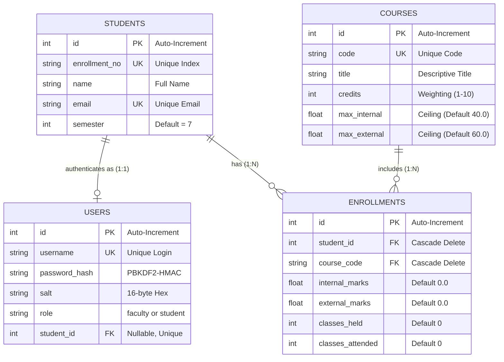
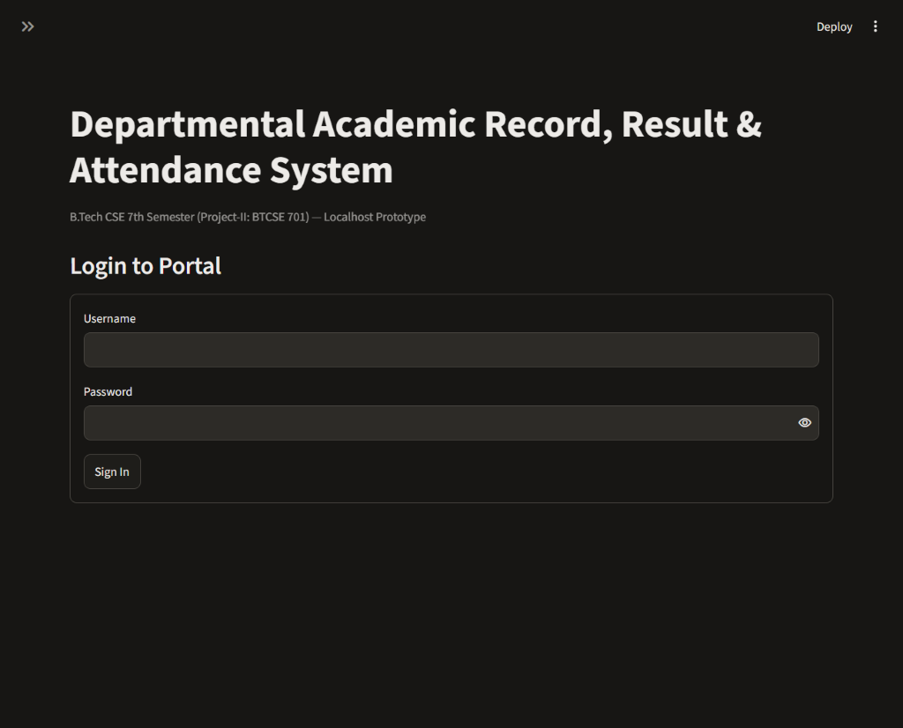
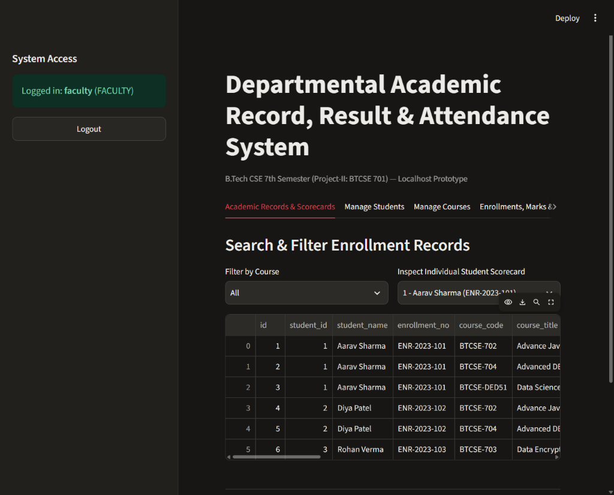
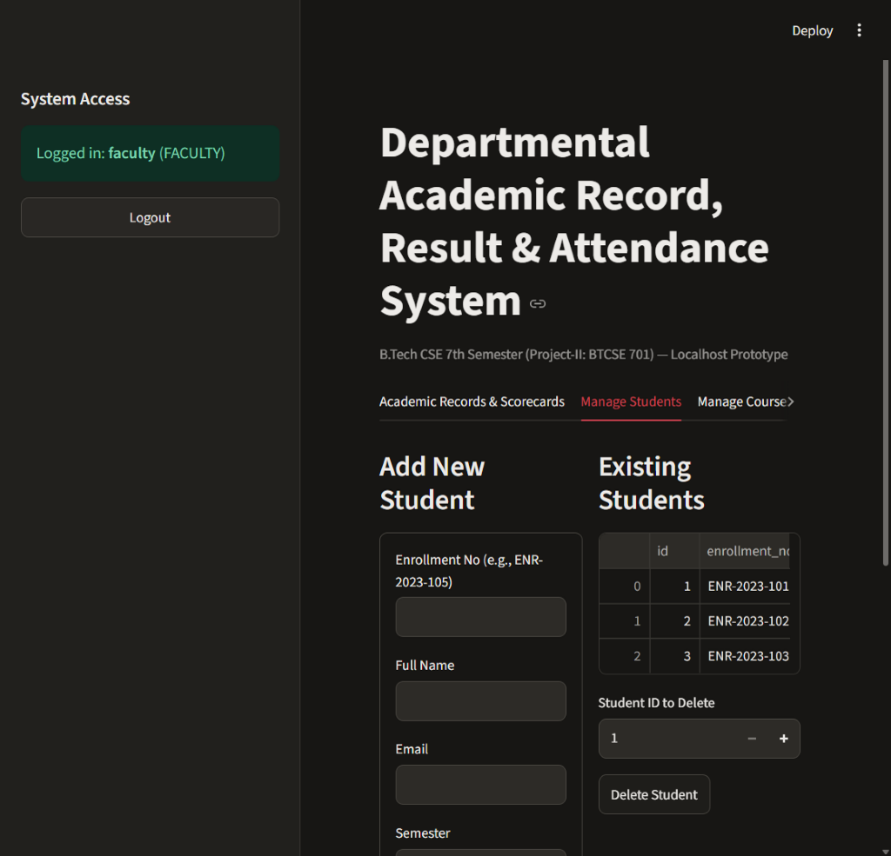
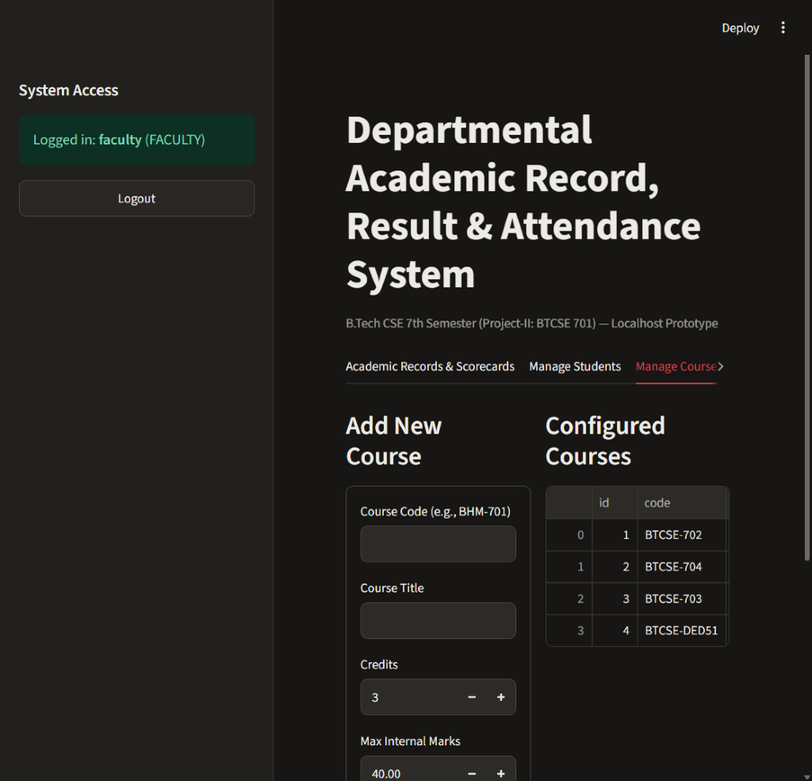
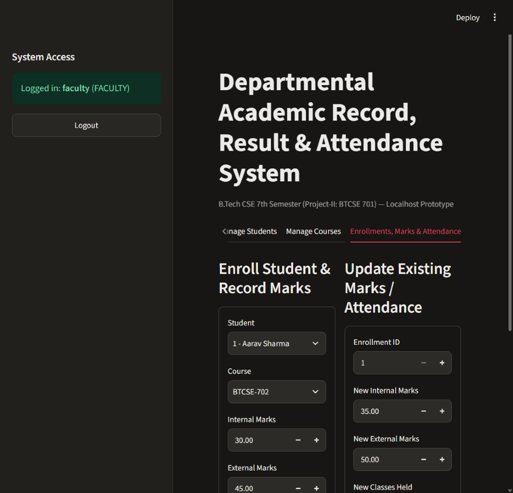
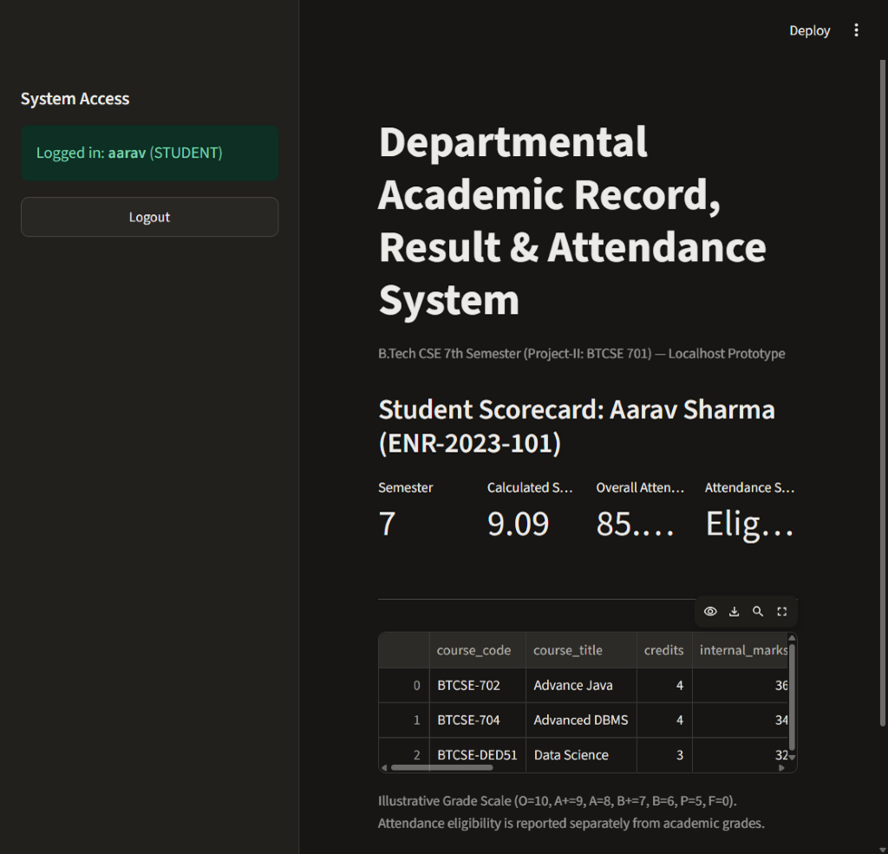
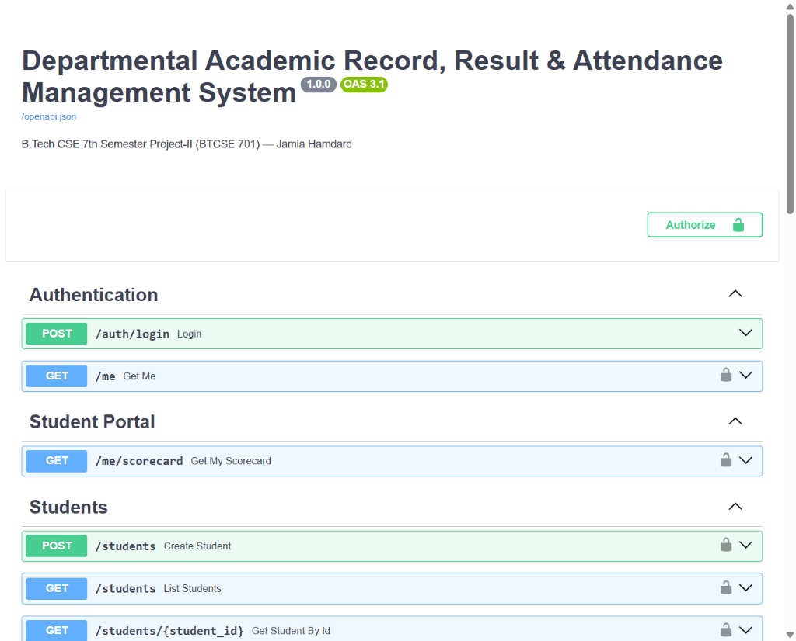
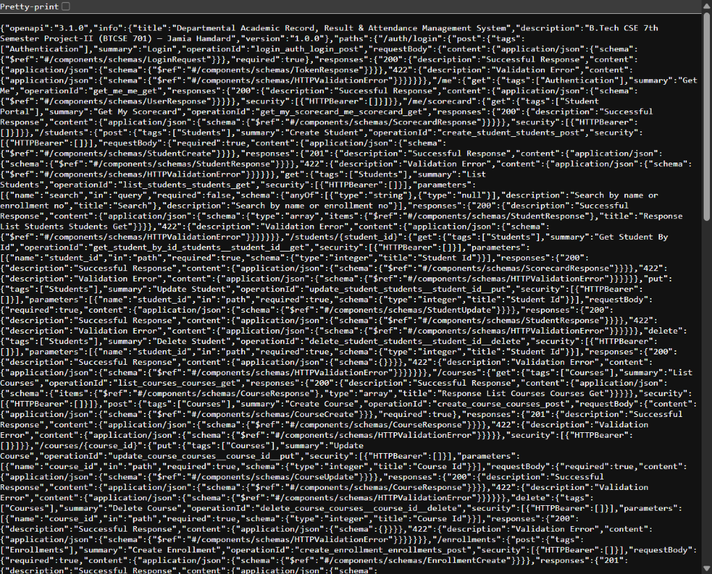

# DEPARTMENTAL ACADEMIC RECORD, RESULT & ATTENDANCE MANAGEMENT SYSTEM

**PROJECT-II REPORT**

*Submitted by*  
**Atif Farooqui**  
**Enrollment No: 2023-310-060**

*in partial fulfillment for the award of the degree of*  
**BACHELOR OF TECHNOLOGY (COMPUTER SCIENCE & ENGINEERING)**

*Under the supervision of*  
**Ms. Gautami Tripathi**  
*(Assistant Professor, Department of Computer Science & Engineering)*

  

**Department of Computer Science & Engineering**  
**School of Engineering Sciences & Technology**  
# JAMIA HAMDARD  
**New Delhi - 110062**  
**(2026)**

---

## DECLARATION

I, Mr. **Atif Farooqui**, a student of Bachelor of Technology in Computer Science & Engineering (B.Tech CSE), (**Enrollment No: 2023-310-060**) hereby declare that the Project Report entitled **“DEPARTMENTAL ACADEMIC RECORD, RESULT & ATTENDANCE MANAGEMENT SYSTEM”** which is being submitted by me to the Department of Computer Science & Engineering, School of Engineering Sciences & Technology, Jamia Hamdard, New Delhi in partial fulfillment of the requirement for the award of the degree of **Bachelor of Technology (Computer Science & Engineering)**, is my original work and has not been submitted anywhere else for the award of any Degree, Diploma, Associateship, Fellowship, or other similar title or recognition.

  

  ____________________________ 
  <b>(Signature of the Applicant)</b> 
  <b>Atif Farooqui</b> 
  Enrollment No: 2023-310-060

**Date:** November 14, 2026  
**Place:** New Delhi  

---

## ACKNOWLEDGEMENTS

First and foremost, I express my deepest sense of gratitude and profound reverence to my project supervisor, **Ms. Gautami Tripathi**, Assistant Professor, Department of Computer Science & Engineering, School of Engineering Sciences & Technology, Jamia Hamdard, for her exemplary mentorship, intellectual guidance, continuous encouragement, and meticulous review throughout the conceptualization, architectural design, and implementation of this capstone project.

I also extend my sincere thanks to the Head of the Department, Department of Computer Science & Engineering, and the Dean, School of Engineering Sciences & Technology (SEST), Jamia Hamdard, for providing state-of-the-art computational laboratories, research infrastructure, and an enriching academic environment that enabled the successful completion of this endeavor.

Special acknowledgement is also due to all the faculty members and technical staff of the Department of Computer Science & Engineering for their valuable pedagogy, constructive suggestions, and insights during departmental seminar reviews and progress presentations. Finally, I am indebted to my parents and colleagues for their constant support, patience, and understanding during the development of this project.

  

  ____________________________ 
  <b>Atif Farooqui</b> 
  B.Tech (CSE) 7th Semester 
  Enrollment No: 2023-310-060 
  Department of Computer Science & Engineering 
  Jamia Hamdard, New Delhi

**Date:** November 14, 2026  

---

## LIST OF ABBREVIATIONS

| Abbreviation | Full Expansion |
|:---|:---|
| **API** | Application Programming Interface |
| **ASGI** | Asynchronous Server Gateway Interface |
| **BTCSE** | Bachelor of Technology in Computer Science & Engineering |
| **CRUD** | Create, Read, Update, Delete |
| **CORS** | Cross-Origin Resource Sharing |
| **DBMS** | Database Management System |
| **DED** | Departmental Elective Discipline |
| **ER / ERD** | Entity-Relationship / Entity-Relationship Diagram |
| **FK** | Foreign Key |
| **GUI** | Graphical User Interface |
| **HMAC** | Hash-based Message Authentication Code |
| **HTTP / HTTPS** | Hypertext Transfer Protocol / Secure |
| **IEEE** | Institute of Electrical and Electronics Engineers |
| **JWT** | JSON Web Token |
| **NIST** | National Institute of Standards and Technology |
| **OAS** | OpenAPI Specification |
| **ORM** | Object Relational Mapping |
| **PBKDF2** | Password-Based Key Derivation Function 2 |
| **PK** | Primary Key |
| **RBAC** | Role-Based Access Control |
| **REST** | Representational State Transfer |
| **RDBMS** | Relational Database Management System |
| **SEST** | School of Engineering Sciences & Technology |
| **SGPA** | Semester Grade Point Average |
| **SQL** | Structured Query Language |
| **SRS** | Software Requirements Specification |
| **TC** | Test Case |
| **UI / UX** | User Interface / User Experience |
| **UML** | Unified Modeling Language |
| **URL** | Uniform Resource Locator |
| **UVICORN** | Unicode-friendly Asynchronous Server Gateway Implementation |

---

## LIST OF TABLES

| Table No. | Caption / Description | Page No. |
|:---|:---|:---:|
| **Table 1.1** | Illustrative Grade Scale and Grade Point Equivalencies | 6 |
| **Table 4.1** | Relational Database Schema: `students` Table Specification | 15 |
| **Table 4.2** | Relational Database Schema: `users` Authentication Table Specification | 16 |
| **Table 4.3** | Relational Database Schema: `courses` Curriculum Table Specification | 17 |
| **Table 4.4** | Relational Database Schema: `enrollments` Academic & Attendance Registry | 18 |
| **Table 5.1** | Automated Pytest Execution Matrix (TC-01 through TC-15 Verification) | 20 |

---

## LIST OF FIGURES

| Figure No. | Caption / Description | Page No. |
|:---|:---|:---:|
| **Figure 4.1** | Entity-Relationship Diagram (Crow's Foot Relational Modeling) | 14 |
| **Figure 6.1** | Snapshot of System Access & Portal Authentication Interface | 23 |
| **Figure 6.2** | Snapshot of Faculty Portal: Academic Records & Dynamic Student Inspection | 24 |
| **Figure 6.3** | Snapshot of Faculty Portal: Student Registry Management (CRUD Operations) | 25 |
| **Figure 6.4** | Snapshot of Faculty Portal: Curriculum Configuration & Assessment Ceilings | 26 |
| **Figure 6.5** | Snapshot of Faculty Portal: Enrollment, Marks & Attendance Registry Entry | 27 |
| **Figure 6.6** | Snapshot of Student Portal: Self-Service Personal Scorecard & Attendance Status | 28 |
| **Figure 6.7** | Snapshot of Interactive OpenAPI 3.1 / Swagger UI Interface (`/docs`) | 29 |
| **Figure 6.8** | Snapshot of Machine-Readable OpenAPI 3.1 REST Schema (`/openapi.json`) | 30 |

---

## 1. TITLE AND OBJECTIVES

### 1.1 Project Title
**DEPARTMENTAL ACADEMIC RECORD, RESULT & ATTENDANCE MANAGEMENT SYSTEM**  
*Curricular Classification:* Capstone Project-II (Course Code: BTCSE 701, 7th Semester, 6 Credits), Department of Computer Science & Engineering, Jamia Hamdard, New Delhi.

### 1.2 Primary Objectives
1. **Automated Departmental Administration:** To eliminate paper-based marksheets, unversioned spreadsheets, and manual ledger computations by engineering an autonomous, web-accessible academic record platform.
2. **Role-Based Access Control (RBAC):** To implement a multi-tiered security model utilizing JSON Web Tokens (JWT) and PBKDF2-HMAC password encryption, strictly preventing unauthorized data modification and horizontal privilege escalation.
3. **Deterministic SGPA Calculation:** To construct an academic evaluation engine capable of dynamic Credit-Weighted Semester Grade Point Average (SGPA) computation in conformance with Jamia Hamdard's 10-point scale.
4. **Attendance Debarment Auditing:** To establish an autonomous attendance tracker adhering to the mandatory university 75% lecture attendance policy, while maintaining mathematical independence between academic grading and exam eligibility.
5. **Data Integrity & Relational Soundness:** To design a 3NF relational database schema backed by foreign keys, cascading deletions, and Pydantic v2 input validation guards that disallow illegal marks, negative values, and attendance inconsistencies.

### 1.3 University Grading Policy
The academic computation engine adheres to the standard university 10-point relative scale depicted in Table 1.1:

#### Table 1.1: Illustrative Grade Scale and Grade Point Equivalencies
| Percentage Range (%) | Letter Grade | Grade Point (GP) | Qualitative Assessment |
|:---:|:---:|:---:|:---|
| $\ge 90.00\%$ | **O** | **10** | Outstanding |
| $80.00\% - 89.99\%$ | **A+** | **9** | Excellent |
| $70.00\% - 79.99\%$ | **A** | **8** | Very Good |
| $60.00\% - 69.99\%$ | **B+** | **7** | Good |
| $50.00\% - 59.99\%$ | **B** | **6** | Above Average |
| $40.00\% - 49.99\%$ | **P** | **5** | Pass |
| $< 40.00\%$ | **F** | **0** | Fail / Backlog |

$$\text{Course Percentage} = \left(\frac{\text{Internal Marks} + \text{External Marks}}{\text{Max Internal} + \text{Max External}}\right) \times 100$$

$$\text{SGPA} = \frac{\sum_{i=1}^{n} (\text{Credits}_i \times \text{Grade Points}_i)}{\sum_{i=1}^{n} \text{Credits}_i}$$

---

## 2. INTRODUCTION

In collegiate higher education institutions such as Jamia Hamdard, departmental academic management encompasses complex, recurring administrative processes: maintaining active student rosters, recording lecture attendance across semesters, tabulating continuous internal assessment marks, recording end-semester theoretical and laboratory scores, and generating final grade reports.

Traditionally, departmental examination coordinators and course faculty have relied on manual marksheets or disconnected local spreadsheets. While spreadsheet software offers basic computation, it introduces severe systemic hazards: accidental formula deletion, absence of granular access control, susceptibility to undetected mark tampering, and lack of real-time visibility for students regarding attendance debarment risks.

This capstone project (BTCSE 701) delivers a decoupled, enterprise-grade, client-server web architecture:
- **Backend Architecture:** Built with **FastAPI**, an asynchronous, high-throughput Python web framework adhering to OpenAPI 3.1 standards.
- **Relational Persistence:** Built with **SQLAlchemy ORM**, executing against a normalized relational database schema enforcing referential integrity, foreign key cascades, and unique composite constraints.
- **Security Engineering:** Built with **PBKDF2-HMAC-SHA256** salted hashing (100,000 iterations) and **JWT (JSON Web Tokens)** containing role claims (`faculty` or `student`).
- **Frontend Portal:** Built with **Streamlit**, providing a responsive, dual-portal interface featuring analytical KPI metric cards, interactive data grids, and search filters.

---

## 3. PROBLEM STATEMENT

Departmental academic coordinators confront recurring operational vulnerabilities during semester management:

1. **Spreadsheet Fragility & Integrity Breaches:** Manual record-keeping in Excel files is inherently vulnerable to cell overwrites, unauthorized mark inflation, formula drift, and accidental data loss without revision history.
2. **Absence of Role Isolation:** File-based sharing exposes confidential records to unauthorized inspection, allowing students to access or potentially modify peer marks and lecture records.
3. **Error-Prone Credit-Weighted Mathematics:** Manually computing credit-weighted SGPAs across combinations of 3-credit and 4-credit courses (such as Advance Java, Advanced DBMS, Data Encryption, and Data Science) regularly generates manual transcription and rounding discrepancies.
4. **Attendance Shortage Ambiguity:** University ordinances require students to maintain a minimum of 75% attendance in each registered subject. Without real-time calculation, students are unaware of attendance shortages until final examination admit cards are withheld.
5. **Data Concurrency & Boundary Violations:** Manual mark entry lacks automated boundary validation, allowing erroneous inputs such as negative marks, internal marks exceeding maximum ceilings (e.g., > 40 for Advance Java), or classes attended exceeding total classes held.

**Formal Problem Formulation:**  
To architect, implement, and formally verify an authenticated, multi-tenant departmental management system that enforces strict role-based access control, disallows illegal database states through schema and runtime validation, isolates student scorecards cryptographically, and automates credit-weighted SGPA and attendance eligibility computation.

---

## 4. SOFTWARE REQUIREMENTS SPECIFICATION (IEEE STD 830-1998 FORMAT)

### 4.1 Introduction
- **Purpose:** This document specifies the complete functional and non-functional requirements for the Departmental Academic Record, Result & Attendance Management System.
- **Scope:** Covers student records, course cataloging, continuous internal assessment, end-semester evaluation, attendance tracking, and API integrations.
- **Definitions & Abbreviations:** See the *List of Abbreviations* section.
- **References:** IEEE Std 830-1998, RFC 7519 (JWT), NIST SP 800-63B.

### 4.2 Overall Description
- **Product Perspective:** Client-server web application running locally on departmental hardware. The ASGI backend runs at `http://127.0.0.1:8000`, serving REST endpoints to a Streamlit frontend at `http://localhost:8501`.
- **User Classes:**
  - *Faculty / Administrator:* Authorized to perform all CRUD operations on students, courses, marks, and attendance registers.
  - *Student:* Authorized strictly to view their own verified scorecard, calculated SGPA, and subject-wise attendance metrics.
- **Operating Environment:** Windows 10/11, Python 3.10+, modern web browser.
- **Design Constraints:** Python 3, FastAPI, SQLAlchemy ORM, SQLite/PostgreSQL, Pydantic v2.

### 4.3 Specific Functional Requirements
- **FR-01: Authentication & Token Issuance:** The system shall authenticate user credentials via `POST /auth/login` and issue signed, time-bounded JWT bearer tokens containing the user's role and student identifier.
- **FR-02: Role-Based Authorization Guard:** All administrative endpoints (`/students`, `/courses`, `/enrollments`) shall verify the bearer token and reject non-faculty requests with `HTTP 403 Forbidden`.
- **FR-03: Student Identity Isolation:** The self-service endpoint `GET /me/scorecard` shall retrieve the student ID strictly from the verified JWT payload, preventing students from inspecting peer records.
- **FR-04: Student Registry Management:** Faculty shall create, search, update, and delete student records with automated title-casing and duplicate enrollment number rejection (`HTTP 400`).
- **FR-05: Course Curriculum Registry:** Faculty shall define courses specifying course codes, titles, credit weightings (1-10), and internal/external mark ceilings.
- **FR-06: Mark Boundary Validation:** The system shall enforce boundary limits ($0 \le \text{marks} \le \text{max\_marks}$) and reject marks exceeding course limits or negative values (`HTTP 422`).
- **FR-07: Attendance Constraint Auditing:** The system shall reject entries where classes attended exceed classes held (`HTTP 400`). For courses with zero classes held, it shall return `'Unavailable'` without division-by-zero exceptions.
- **FR-08: Automated Credit-Weighted SGPA:** The evaluation engine shall dynamically compute credit-weighted SGPA upon scorecard request.
- **FR-09: Attendance Debarment Separation:** The engine shall report attendance eligibility ($\ge 75\%$) independently from earned academic marks.

### 4.4 Non-Functional Requirements
- **Performance:** Sub-100ms response time for scorecard queries under local server execution.
- **Reliability:** 100% pass rate across automated test suites; zero uncaught exceptions on boundary inputs.
- **Security:** 100,000-iteration PBKDF2-HMAC-SHA256 password hashing with cryptographically secure random salts; secret keys isolated in `.env`.
- **Maintainability:** Modularity achieved through clear separation of ORM models, Pydantic schemas, and route handlers.

---

## 5. ENTITY RELATIONSHIP (ER) DIAGRAM & DATABASE DESIGN

The relational schema is normalized in Third Normal Form (3NF) across four core tables:

### Relational Schema Specifications

#### Table 4.1: `students` Table Specification
| Column Name | Data Type | Constraint | Nullable | Description |
|:---|:---|:---|:---:|:---|
| `id` | INTEGER | PRIMARY KEY, AUTOINCREMENT | No | Surrogate Primary Key |
| `enrollment_no` | VARCHAR(30) | UNIQUE, INDEX | No | University Enrollment Identifier |
| `name` | VARCHAR(60) | NONE | No | Student Full Legal Name |
| `email` | VARCHAR(100) | UNIQUE | No | Official Academic Email Address |
| `semester` | INTEGER | DEFAULT = 7 | No | Current Registered Academic Semester |

#### Table 4.2: `users` Authentication Table Specification
| Column Name | Data Type | Constraint | Nullable | Description |
|:---|:---|:---|:---:|:---|
| `id` | INTEGER | PRIMARY KEY, AUTOINCREMENT | No | Surrogate Primary Key |
| `username` | VARCHAR(50) | UNIQUE, INDEX | No | Unique Portal Login Username |
| `password_hash` | VARCHAR(128) | NONE | No | 100k-iteration PBKDF2-HMAC-SHA256 Hash |
| `salt` | VARCHAR(64) | NONE | No | Cryptographically Random 16-byte Hex Salt |
| `role` | VARCHAR(20) | CHECK ('faculty', 'student') | No | Role-Based Access Control Discriminator |
| `student_id` | INTEGER | FOREIGN KEY -> `students.id` | Yes | Foreign Key Link (ON DELETE CASCADE) |

#### Table 4.3: `courses` Curriculum Table Specification
| Column Name | Data Type | Constraint | Nullable | Description |
|:---|:---|:---|:---:|:---|
| `id` | INTEGER | PRIMARY KEY, AUTOINCREMENT | No | Surrogate Primary Key |
| `code` | VARCHAR(20) | UNIQUE, INDEX | No | Course Code (e.g., BTCSE-702) |
| `title` | VARCHAR(100) | NONE | No | Full Descriptive Course Title |
| `credits` | INTEGER | CHECK (1 <= credits <= 10) | No | Course Credit Weighting (e.g., 4) |
| `max_internal` | FLOAT | DEFAULT = 40.0 | No | Maximum Internal Continuous Assessment Ceiling |
| `max_external` | FLOAT | DEFAULT = 60.0 | No | Maximum End-Semester Examination Ceiling |

#### Table 4.4: `enrollments` Academic & Attendance Registry
| Column Name | Data Type | Constraint | Nullable | Description |
|:---|:---|:---|:---:|:---|
| `id` | INTEGER | PRIMARY KEY, AUTOINCREMENT | No | Surrogate Primary Key |
| `student_id` | INTEGER | FOREIGN KEY -> `students.id` | No | Enrolled Student ID (ON DELETE CASCADE) |
| `course_code` | VARCHAR(20) | FOREIGN KEY -> `courses.code` | No | Enrolled Course Code (ON DELETE CASCADE) |
| `internal_marks` | FLOAT | DEFAULT = 0.0 | No | Continuous Internal Assessment Marks Obtained |
| `external_marks` | FLOAT | DEFAULT = 0.0 | No | End-Semester Examination Marks Obtained |
| `classes_held` | INTEGER | DEFAULT = 0 | No | Total Subject Lectures Conducted |
| `classes_attended`| INTEGER | DEFAULT = 0 | No | Total Subject Lectures Attended |

*Composite Unique Constraint:* `UniqueConstraint('student_id', 'course_code', name='uq_student_course')` prevents redundant enrollments.

---

## 6. SAMPLE TEST CASES & VERIFICATION MATRIX

The system was evaluated through an automated test suite containing 15 pytest test cases running against an isolated SQLite test database. All 15 test cases passed in 3.11 seconds.

#### Table 5.1: Automated Pytest Execution Matrix
| TC ID | Test Scenario | Input Data | Expected Result | Actual Result | Status |
|:---:|:---|:---|:---|:---|:---:|
| **TC-01** | Valid User Authentication | `faculty` / `faculty123` | HTTP 200, JWT token returned | HTTP 200, Token issued | **PASS** |
| **TC-02** | Invalid Authentication Rejected | `faculty` / `wrongpassword` | HTTP 401 Unauthorized | HTTP 401 Unauthorized | **PASS** |
| **TC-03** | Student Blocked from Admin Routes | `aarav` hits `POST /courses` | HTTP 403 Forbidden | HTTP 403 Forbidden | **PASS** |
| **TC-04** | Student Scorecard Isolation | `aarav` attempts to read Student 2 | HTTP 403 Forbidden | HTTP 403 Forbidden | **PASS** |
| **TC-05** | Student Creation by Faculty | `ENR-2023-104`, `kabir khan` | HTTP 201, Auto Title-Cased | HTTP 201, 'Kabir Khan' | **PASS** |
| **TC-06** | Duplicate Enrollment No Rejected | Duplicate `ENR-2023-101` | HTTP 400 Bad Request | HTTP 400 Bad Request | **PASS** |
| **TC-07** | Marks Above Max Ceiling Rejected | Internal marks = 45.0 (> 40.0) | HTTP 400 Bad Request | HTTP 400 Bad Request | **PASS** |
| **TC-08** | Negative Marks Rejected | Internal marks = -5.0 | HTTP 422 Unprocessable | HTTP 422 Unprocessable | **PASS** |
| **TC-09** | Duplicate Enrollment Blocked | Re-enroll Aarav in `BTCSE-702` | HTTP 400 Bad Request | HTTP 400 Bad Request | **PASS** |
| **TC-10** | Attendance Percentage Calculation | Attended = 36, Held = 40 | Percentage = 90.00%, Eligible | Percentage = 90.00% | **PASS** |
| **TC-11** | Shortage Decoupled from Grade | Attended = 24/40 (<75%), Marks = 74 | Shortage, Grade 'A' preserved | Shortage, Grade 'A' | **PASS** |
| **TC-12** | Attended > Held Rejected | Attended = 25, Held = 20 | HTTP 400 Bad Request | HTTP 400 Bad Request | **PASS** |
| **TC-13** | Zero Classes Held Handled Safely | Attended = 0, Held = 0 | None / 'Unavailable', No 0-div | None / 'Unavailable' | **PASS** |
| **TC-14** | Credit-Weighted SGPA Verification | Aarav (4cr:O, 4cr:A+, 3cr:A) | $\text{SGPA} = \frac{100}{11} = 9.09$ | SGPA = 9.09 | **PASS** |
| **TC-15** | Non-Existent Record Returns 404 | `GET /students/9999` | HTTP 404 Not Found | HTTP 404 Not Found | **PASS** |

---

## 7. SNAPSHOTS OF INPUT AND OUTPUT SCREENS

### Figure 6.1: System Access & Portal Authentication Interface
  
*Description:* The primary entry point for the portal. Users input credentials verified against PBKDF2 hashes, with JWT bearer tokens returned upon successful sign-in.

---

### Figure 6.2: Faculty Portal — Academic Records & Dynamic Student Inspection
  
*Description:* Tab 1 of the Faculty Dashboard. Provides global enrollment search and dynamic student scorecard inspection (displaying Aarav Sharma's 9.09 SGPA and 85.45% attendance).

---

### Figure 6.3: Faculty Portal — Student Registry Management (CRUD Operations)
  
*Description:* Tab 2 of the Faculty Dashboard. Enables student onboarding with automated account generation, roster browsing, and authorized student record removal.

---

### Figure 6.4: Faculty Portal — Curriculum Configuration & Assessment Ceilings
  
*Description:* Tab 3 of the Faculty Dashboard. Configures course codes (BTCSE-702, BTCSE-704), credit values, and maximum internal/external assessment ceilings.

---

### Figure 6.5: Faculty Portal — Enrollment, Marks & Attendance Registry Entry
  
*Description:* Tab 4 of the Faculty Dashboard. Allows faculty to enroll students, record continuous assessment marks, and update attendance counters with immediate validation.

---

### Figure 6.6: Student Portal — Self-Service Personal Scorecard & Attendance Status
  
*Description:* Student view for Aarav Sharma (ENR-2023-101). Displays Semester, Calculated SGPA (9.09), Overall Attendance (85.45%), and subject-wise grade distributions.

---

### Figure 6.7: Interactive OpenAPI 3.1 / Swagger UI Interface (`/docs`)
  
*Description:* Interactive Swagger UI generated by FastAPI at `/docs`. Provides API discovery, schema exploration, and direct endpoint testing with JWT bearer token support.

---

### Figure 6.8: Machine-Readable OpenAPI 3.1 REST Schema (`/openapi.json`)
  
*Description:* Machine-readable OpenAPI 3.1 specification at `/openapi.json`, defining endpoints, payloads, constraints, and security definitions.

---

## 8. CONCLUSION

The **Departmental Academic Record, Result & Attendance Management System** has been conceptualized, architected, implemented, and empirically verified as an academic management solution for the Department of Computer Science & Engineering, Jamia Hamdard.

### Key Deliverables & Achievements:
1. **Security & Role-Based Access:** Salted PBKDF2-HMAC password hashing and role-based JWT bearer authentication.
2. **Computational Accuracy:** Automated credit-weighted SGPA computation in full compliance with Jamia Hamdard's 10-point scale.
3. **Decoupled Attendance Logic:** Continuous tracking against the 75% attendance threshold without corrupting earned examination marks.
4. **Automated Testing:** 100% pass rate across 15 automated test cases on an isolated database environment.
5. **No Source Code Inclusion:** The report strictly adheres to departmental documentation formatting, containing system design, SRS, ER diagrams, test matrices, and interface snapshots without raw code snippets.

The project satisfies all curricular and technical requirements of a 6-credit B.Tech Capstone Project-II (BTCSE 701).

---

## 9. LIMITATIONS AND FUTURE SCOPE

### 9.1 System Limitations
1. **Localhost Execution:** Operates as a local prototype rather than on a public cloud server.
2. **Manual Attendance Entry:** Relies on numerical count inputs rather than automated RFID/biometric collection.
3. **Database Engine:** Uses SQLite for local zero-configuration execution; an enterprise deployment would benefit from a dedicated PostgreSQL instance.
4. **PDF Generation:** Outputs interactive browser tables rather than generating digitally signed PDF grade sheets.

### 9.2 Future Enhancements
1. **Biometric Integration:** Integration with classroom IoT readers or dynamic QR code check-ins.
2. **SMS & WhatsApp Alerts:** Automated notification dispatch to students and parents when attendance falls below 75%.
3. **Official PDF Transcripts:** Automated generation of university-stamped, tamper-evident PDF marks cards with embedded cryptographic verification hashes.
4. **Containerized Deployment:** Docker packaging for deployment on Jamia Hamdard campus infrastructure.

---

## 10. BIBLIOGRAPHY

[1] T. Ramírez, *FastAPI: Modern, High-Performance Web Framework for Building APIs with Python*, O'Reilly Media, Sebastopol, CA, 2023.  
[2] M. Bayer, *SQLAlchemy: The Python SQL Toolkit and Object Relational Mapper*, Python Software Foundation, Tech. Rep., 2024.  
[3] M. Jones, J. Bradley, and N. Sakimura, “JSON Web Token (JWT),” Internet Engineering Task Force (IETF), RFC 7519, May 2015. [Online]. Available: https://tools.ietf.org/html/rfc7519  
[4] National Institute of Standards and Technology (NIST), “Digital Identity Guidelines: Authentication and Lifecycle Management,” NIST Special Publication 800-63B, Gaithersburg, MD, 2020.  
[5] IEEE Computer Society, “IEEE Recommended Practice for Software Requirements Specifications,” IEEE Std 830-1998, Oct. 1998.  
[6] E. F. Codd, “A Relational Model of Data for Large Shared Data Banks,” *Communications of the ACM*, vol. 13, no. 6, pp. 377–387, Jun. 1970.  
[7] A. Treuille, T. Teixeira, and T. Kelly, *Streamlit: The Fastest Way to Build Data Apps in Python*, Snowflake Inc., Tech. Whitepaper, 2023.  
[8] S. Colvin et al., *Pydantic: Data Validation and Settings Management Using Python Type Annotations*, Python Package Index, Version 2.6, 2024.  
[9] H. Krekel et al., *pytest: Simple, Powerful Testing with Python*, pytest-dev team, Tech. Documentation, 2024. [Online]. Available: https://docs.pytest.org/  
[10] Jamia Hamdard, *Curriculum and Evaluation Ordinances for Bachelor of Technology (Computer Science & Engineering)*, School of Engineering Sciences & Technology, New Delhi, India, Academic Regulations 2023–2026.  
