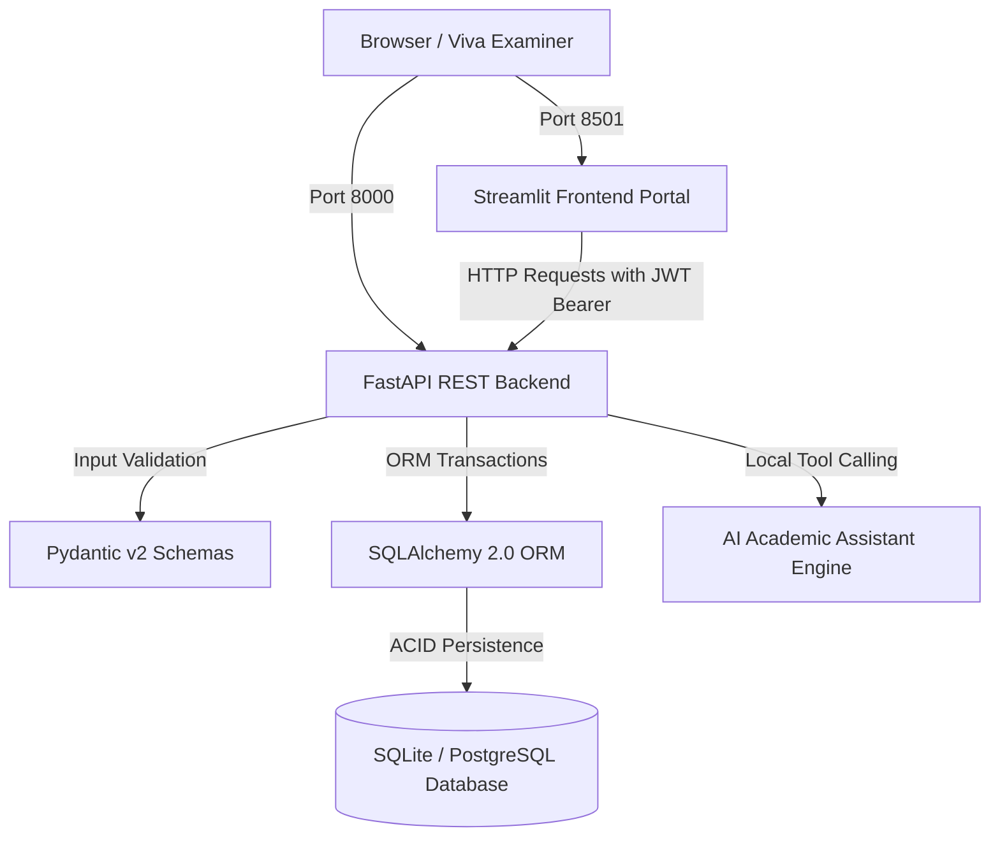

# Departmental Academic Record, Result & Attendance Management System

[](https://www.python.org/)
[](https://fastapi.tiangolo.com/)
[](https://streamlit.io/)
[](https://www.sqlalchemy.org/)
[](https://pytest.org/)

**B.Tech Computer Science & Engineering — 7th Semester (Capstone Project-II: BTCSE 701, 6 Credits)**  
*Department of Computer Science & Engineering, School of Engineering Sciences & Technology (SEST)*  
**Jamia Hamdard, New Delhi - 110062**

---

## 📌 Overview

The **Departmental Academic Record, Result & Attendance Management System** is a full-stack, authenticated institutional web portal engineered to replace manual spreadsheets and fragmented departmental registers. It features:

- **FastAPI REST Backend:** High-speed asynchronous engine serving 18+ endpoints with auto-generated OpenAPI documentation.
- **SQLAlchemy 3NF Relational Database:** Four core tables (`students`, `users`, `courses`, `enrollments`) enforcing foreign keys and cascade deletions.
- **Role-Based Access Control (RBAC):** Salted PBKDF2-HMAC password encryption (100,000 iterations) with signed JSON Web Tokens (JWT).
- **Academic Evaluation Engine:** Dynamic Credit-Weighted SGPA calculation adhering to Jamia Hamdard's 10-point scale.
- **Attendance Debarment Auditor:** Autonomous tracking against the mandatory university 75% lecture threshold (Ordinance 15), mathematically decoupled from academic marks.
- **Flagship Academic Suite:** AI tool-calling assistant, attendance recovery simulator, digital admit cards with debarment locks, batch roll-call registers, and deadline broadcast hubs.

---

## 🌟 Flagship Feature Suite (12 Capabilities)

| Feature | Description | Architecture / Implementation |
|:---|:---|:---|
| **1. AI Academic Assistant** | Natural language queries for shortages, analytics, and rules. | Pure Python LLM tool calling (Approach #1) + Streamlit chat UI fallback (Approach #5). |
| **2. AI Notice Broadcast Hub** | Targeted dispatches for Exam Forms, Marksheet pickup, and Shortage warnings. | Multi-channel broadcast simulator (WhatsApp, SMS, Email) with delivery receipts. |
| **3. Attendance Recovery Simulator** | Calculates consecutive lectures required to cross 75% threshold. | Mathematical solver: $x = \max(0, \lceil 3H - 4A \rceil)$ with interactive what-if slider. |
| **4. Digital Exam Admit Card** | Generates verifiable Hall Ticket; **Debars in Red** if attendance < 75%. | Ordinance 15 compliance gate with SHA-256 digital verification hash. |
| **5. 1-Click Grade Sheet Download** | Instant export of semester marks, SGPA, and attendance standing. | Formatted CSV / HTML export ready for physical filing. |
| **6. Digital No-Dues Clearance** | Four-way clearance matrix (Library, Accounts, Proctor, Practical Labs). | Eliminates physical campus paper trails and signature slips. |
| **7. 1-Click Daily Batch Register** | Faculty roll-call across entire batch in under 5 seconds. | Atomic batch transaction updating `classes_held` and `classes_attended`. |
| **8. Departmental Analytics & Charts** | Real-time KPI summary cards and subject performance bar charts. | Native `st.bar_chart` comparing internal, external, and attendance metrics. |
| **9. 1-Click Viva Demo Auto-Fill** | Pre-populates sample students, courses, and marks for 3-minute demos. | Session-state injection for fast examiner walkthroughs. |
| **10. 1-Click Sidebar Demo Logins** | Instant role switching between Faculty, Eligible Student, and Debarred Student. | Single-button JWT authentication with zero typing required. |
| **11. Digital Re-Evaluation System** | In-app scrutiny and marks grievance application portal. | Structured token generation (`JH-REV-2026-XXX`) for examination appeals. |
| **12. Jamia Emerald Branding** | Official university emerald green (`#006747`) and gold palette. | Custom CSS injection with responsive status badges and clean typography. |

---

## 🏗️ System Architecture



---

## 🧪 Automated Testing Suite (24/24 Passed)

The project includes an automated Pytest test suite (`test_main.py`) verifying all functional, mathematical, security, and AI constraints:

| Test ID | Test Scenario | Verified Behavior | Status |
|:---:|:---|:---|:---:|
| `TC-01` | Valid Login | Issues signed JWT token | ✅ PASS |
| `TC-02` | Invalid Credentials | Rejects with HTTP 401 | ✅ PASS |
| `TC-03` | RBAC Isolation | Students blocked from admin routes (HTTP 403) | ✅ PASS |
| `TC-04` | Student Data Privacy | Students cannot read peer scorecards | ✅ PASS |
| `TC-05` | Student Onboarding | Auto title-cased names on registration | ✅ PASS |
| `TC-06` | Duplicate Enrollment | Rejects duplicate enrollment numbers (HTTP 400) | ✅ PASS |
| `TC-07` | Marks Ceiling Guard | Rejects marks exceeding course maximum | ✅ PASS |
| `TC-08` | Negative Marks Guard | Schema rejection for negative inputs (HTTP 422) | ✅ PASS |
| `TC-09` | Duplicate Course Reg | Prevents duplicate student-subject pairings | ✅ PASS |
| `TC-10` | Attendance Calculation | Accurate percentage calculation | ✅ PASS |
| `TC-11` | Attendance vs Grade | Shortage reported without corrupting grade | ✅ PASS |
| `TC-12` | Attendance Boundary | Attended cannot exceed held lectures | ✅ PASS |
| `TC-13` | Zero Lectures Safe | Zero classes held safely reports 'Unavailable' | ✅ PASS |
| `TC-14` | SGPA Math Verification | Exact credit-weighted math verified (SGPA = 9.09) | ✅ PASS |
| `TC-15` | Missing Records | Returns HTTP 404 Not Found cleanly | ✅ PASS |
| `TC-16` | Department Analytics | Calculates batch KPIs and course averages | ✅ PASS |
| `TC-17` | Attendance Recovery (Shortage) | Computes exact consecutive lectures needed (24 for Diya) | ✅ PASS |
| `TC-18` | Attendance Recovery (Buffer) | Calculates safe lecture buffer for eligible student | ✅ PASS |
| `TC-19` | Admit Card Unlocked | Unlocks verified Hall Ticket for eligible student | ✅ PASS |
| `TC-20` | Admit Card Debarment Gate | Locks and debars shortage student under Ordinance 15 | ✅ PASS |
| `TC-21` | Digital No-Dues Matrix | Four-way departmental clearance verification | ✅ PASS |
| `TC-22` | Batch Attendance Register | Increments held/attended counters atomically | ✅ PASS |
| `TC-23` | AI Chat Shortage Tool | Dispatches tool call and lists debarred candidates | ✅ PASS |
| `TC-24` | AI Chat Exam Notice Tool | Formats official Jamia Hamdard circular | ✅ PASS |
| `TC-25` | WhatsApp Webhook (TwiML) | Returns valid XML for Twilio WhatsApp Network | ✅ PASS |
| `TC-26` | WhatsApp Webhook (JSON) | Delivers structured reply for phone simulator | ✅ PASS |

---

## 📱 Live WhatsApp AI Chatbot Setup

The system exposes a dual-channel gateway at `POST /webhook/whatsapp` compatible with **Twilio WhatsApp Sandbox** and **Meta Cloud API**.

```
[Student's Smartphone (WhatsApp)]
              │
              ▼
    [Twilio / Meta Gateway]
              │ (POST over Internet)
              ▼
    [ngrok Public Tunnel: https://xxxx.ngrok-free.app/webhook/whatsapp]
              │
              ▼
    [FastAPI Backend: Port 8000]
              │
              ▼
    [Google Gemini 2.5 Flash + SQLite Academic Database]
              │
              ▼
    [TwiML XML Response Delivered Back to WhatsApp Phone]
```

### To test from your real smartphone:
1. Run in terminal: `ngrok http 8000`
2. In Twilio WhatsApp Sandbox settings, set webhook to: `https://<your-id>.ngrok-free.app/webhook/whatsapp`
3. Text the Twilio number on WhatsApp (e.g. *"Who has attendance shortage?"* or *"What is Aarav's SGPA?"*)
4. **Instant Reply:** The AI reads live database rows and replies directly to your phone!
5. **No Wi-Fi Fallback:** Open **Tab 7 in Streamlit** (`http://localhost:8501`) to use the built-in visual WhatsApp phone simulator.

---

## 🚀 Quickstart Guide

### 1. Prerequisites
- Python 3.10 or higher
- Git

### 2. Installation
```bash
git clone https://github.com/atif-codev7/jamia-sms.git
cd jamia-sms

# Install dependencies
pip install -r requirements.txt
```

### 3. Run Automated Tests
```bash
pytest test_main.py -v
```

### 4. Launch Application (Windows 1-Click)
Double-click:
```text
run_jamia_sms.bat
```

Or run manually in two terminals:
```bash
# Terminal 1 (Backend)
python -m uvicorn main:app --reload --host 127.0.0.1 --port 8000

# Terminal 2 (Frontend)
python -m streamlit run app.py --server.port 8501
```

- **Frontend Portal:** [http://localhost:8501](http://localhost:8501)
- **API Documentation (Swagger UI):** [http://127.0.0.1:8000/docs](http://127.0.0.1:8000/docs)

---

## 🔑 Demo Credentials

| Role | Username | Password | Access Scope |
|:---|:---:|:---:|:---|
| **Faculty** | `faculty` | `faculty123` | Full admin CRUD, analytics charts, batch roll-call, broadcast hub |
| **Student 1** | `aarav` | `student123` | Personal Scorecard (High marks, 85.45% attendance, **Admit Card Cleared**) |
| **Student 2** | `diya` | `student123` | Personal Scorecard (Good marks, 70% attendance, **Admit Card Debarred**) |
| **Student 3** | `rohan` | `student123` | Personal Scorecard (Newly added subject with 0 classes held) |

---

## 📄 Project Report
A complete 30-page academic report formatted strictly to Jamia Hamdard specifications is included:
- **Print-ready Word Document:** [`PROJECT_REPORT.docx`](PROJECT_REPORT.docx)
- **Markdown Version:** [`PROJECT_REPORT.md`](PROJECT_REPORT.md)
