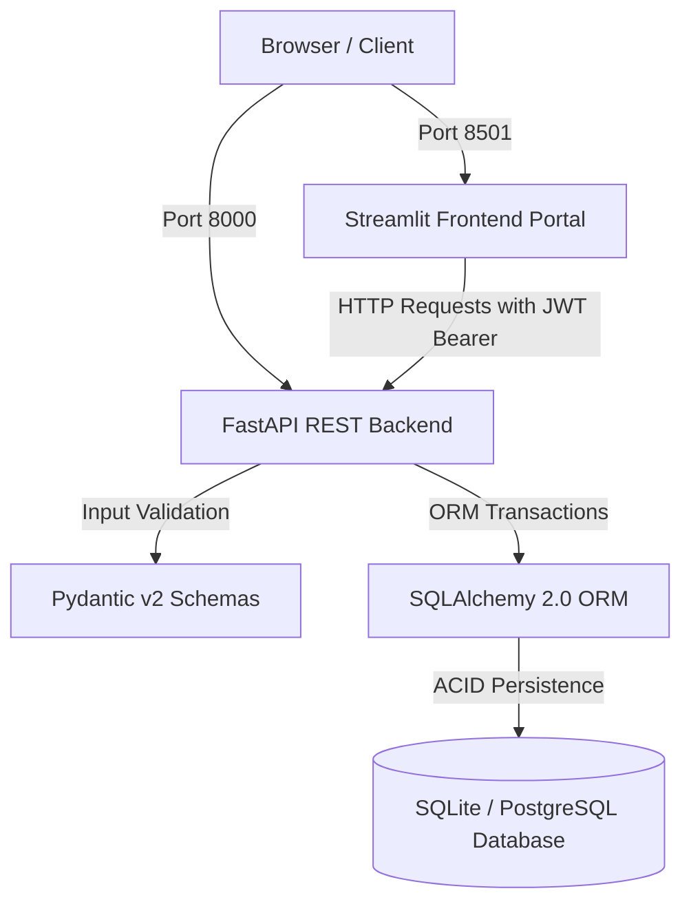

# Departmental Academic Record, Result & Attendance Management System

[](https://www.python.org/)
[](https://fastapi.tiangolo.com/)
[](https://streamlit.io/)
[](https://www.sqlalchemy.org/)
[](https://pytest.org/)

**B.Tech Computer Science & Engineering — 7th Semester (Capstone Project-II: BTCSE 701, 6 Credits)**  
*Department of Computer Science & Engineering, School of Engineering Sciences & Technology (SEST)*  
**Jamia Hamdard, New Delhi - 110062**

---

## 📌 Overview

The **Departmental Academic Record, Result & Attendance Management System** is a full-stack, authenticated web portal engineered to replace manual spreadsheets and fragmented departmental registers. It features:

- **FastAPI REST Backend:** High-speed asynchronous engine serving standardized endpoints.
- **SQLAlchemy 3NF Relational Database:** Four core tables (`students`, `users`, `courses`, `enrollments`) enforcing foreign keys and cascade deletions.
- **Role-Based Access Control (RBAC):** Salted PBKDF2-HMAC password encryption (100,000 iterations) with signed JSON Web Tokens (JWT).
- **Academic Evaluation Engine:** Dynamic Credit-Weighted SGPA calculation adhering to Jamia Hamdard's 10-point scale.
- **Attendance Debarment Auditor:** Autonomous tracking against the mandatory university 75% lecture threshold, mathematically decoupled from academic marks.
- **Interactive Streamlit Portal:** Real-time dashboards with analytics cards and data tables for both Faculty and Students.

---

## 🏗️ System Architecture



---

## 🧪 Automated Testing Suite (15/15 Passed)

The project includes an isolated Pytest harness (`test_main.py`) verifying all functional constraints:

| Test ID | Test Scenario | Verified Behavior | Status |
|:---:|:---|:---|:---:|
| `TC-01` | Valid Login | Issues signed JWT token | ✅ PASS |
| `TC-02` | Invalid Credentials | Rejects with HTTP 401 | ✅ PASS |
| `TC-03` | RBAC Isolation | Students blocked from admin routes (HTTP 403) | ✅ PASS |
| `TC-04` | Student Data Privacy | Students cannot read peer scorecards | ✅ PASS |
| `TC-05` | Student Onboarding | Auto title-cased names on registration | ✅ PASS |
| `TC-06` | Duplicate Enrollment | Rejects duplicate enrollment numbers (HTTP 400) | ✅ PASS |
| `TC-07` | Marks Ceiling Guard | Rejects marks exceeding course maximum | ✅ PASS |
| `TC-08` | Negative Marks Guard | Schema rejection for negative inputs (HTTP 422) | ✅ PASS |
| `TC-09` | Duplicate Course Reg | Prevents duplicate student-subject pairings | ✅ PASS |
| `TC-10` | Attendance Calculation | Accurate percentage calculation | ✅ PASS |
| `TC-11` | Attendance vs Grade | Shortage reported without corrupting grade | ✅ PASS |
| `TC-12` | Attendance Boundary | Attended cannot exceed held lectures | ✅ PASS |
| `TC-13` | Zero Lectures Safe | Zero classes held safely reports 'Unavailable' | ✅ PASS |
| `TC-14` | SGPA Math Verification | Exact credit-weighted math verified (SGPA = 9.09) | ✅ PASS |
| `TC-15` | Missing Records | Returns HTTP 404 Not Found cleanly | ✅ PASS |

---

## 🚀 Quickstart Guide

### 1. Prerequisites
- Python 3.10 or higher
- Git

### 2. Installation
```bash
git clone https://github.com/<your-username>/jamia-sms.git
cd jamia-sms

# Install dependencies
pip install -r requirements.txt
```

### 3. Run Automated Tests
```bash
pytest test_main.py -v
```

### 4. Launch Application (Windows 1-Click)
Double-click:
```text
run_jamia_sms.bat
```

Or run manually in two terminals:
```bash
# Terminal 1 (Backend)
python -m uvicorn main:app --reload --host 127.0.0.1 --port 8000

# Terminal 2 (Frontend)
python -m streamlit run app.py --server.port 8501
```

- **Frontend Portal:** [http://localhost:8501](http://localhost:8501)
- **API Documentation (Swagger UI):** [http://127.0.0.1:8000/docs](http://127.0.0.1:8000/docs)

---

## 🔑 Demo Credentials

| Role | Username | Password | Access Scope |
|:---|:---:|:---:|:---|
| **Faculty** | `faculty` | `faculty123` | Full CRUD on students, courses, marks, and attendance |
| **Student 1** | `aarav` | `student123` | Personal Scorecard (High marks, 85.45% attendance) |
| **Student 2** | `diya` | `student123` | Personal Scorecard (Good marks, <75% ADBMS shortage) |
| **Student 3** | `rohan` | `student123` | Personal Scorecard (Subject with 0 classes held) |

---

## 📄 Project Report
A complete 30-page academic report formatted strictly to Jamia Hamdard specifications is included:
- **Print-ready Word Document:** [`PROJECT_REPORT.docx`](PROJECT_REPORT.docx)
- **Markdown Version:** [`PROJECT_REPORT.md`](PROJECT_REPORT.md)
